# End-to-End Research Workflow & Execution Checklist

**Document Type:** Master Operational Workflow & Execution Protocol  
**Project Title:** *Predictive Maintenance and Anomaly Detection for Industrial IoT Telemetry Using Machine Learning: A Rigorous Empirical Study on NASA C-MAPSS under Leakage-Free Protocols*  
**Corpus Sources:** `project/src/`, `project/results/`, `paper/ieee_paper.tex`, `project/thesis/`, `docs/`  
**Current Project State:** All code implemented, all Stage 1 & 2 experiments complete, 12 figures generated, LaTeX tables exported, 151-metric manifest compiled, and IEEE manuscript draft written.  
**Operational Objective:** Guide the research project from the current state through quality verification, metric auditing, PDF compilation, and final submission.

---

## 1. Master Operational Workflow Diagram (Mermaid)

```mermaid
flowchart TD
    %% =========================================================================
    %% END-TO-END RESEARCH EXECUTION WORKFLOW
    %% =========================================================================

    subgraph PHASE_A ["Phase A: Audit, Integrity & Pipeline Verification"]
        direction TB
        STEP1["Step 1: Code & File Integrity Audit<br/>Input: project/src, data, results<br/>Verify 12 raw files, scripts, and logs"]
        STEP2["Step 2: Completed Work & Gap Analysis<br/>Input: README.md, Process.md, git logs<br/>Differentiate completed code vs. pending audits"]
        STEP3["Step 3: Preprocessing Verification<br/>Input: data_loader.py, regime_norm.py<br/>Verify train-only variance and KMeans k=6"]
        STEP4["Step 4: Training & Evaluation Checks<br/>Input: models.py, run_anomaly.py<br/>Verify 5-fold GroupKFold and 3-cycle latch"]
        STEP1 --> STEP2 --> STEP3 --> STEP4
    end

    subgraph PHASE_B ["Phase B: Results Validation & Traceability Mapping"]
        direction TB
        STEP5["Step 5: Results Reproduction Check<br/>Input: run.log, pytest tests, CSVs<br/>Verify 26 unit/integration tests pass"]
        STEP6["Step 6: Figure & Table Artifact Mapping<br/>Input: 12 PNGs, tables_latex.tex, manifest.csv<br/>Map 151 metrics 1:1 to execution logs"]
        STEP7["Step 7: Literature & Gap Synthesis<br/>Input: paper/background.md, ieee_paper.tex<br/>Synthesize 5 threads & 30 references"]
        STEP4 --> STEP5 --> STEP6 --> STEP7
    end

    subgraph PHASE_C ["Phase C: Three-Part Manuscript Synthesis & Integration"]
        direction TB
        STEP8["Step 8: Finalize Part I (Intro & Background)<br/>Input: Sections I & II of ieee_paper.tex<br/>Verify problem statement, RQs, and references"]
        STEP9["Step 9: Finalize Part II (Methodology & Figures)<br/>Input: Sections III & IV, 12 Figure entries<br/>Embed LaTeX figures with 10-point captions"]
        STEP10["Step 10: Finalize Part III (Results & Discussion)<br/>Input: Sections V, VI, VII of ieee_paper.tex<br/>Integrate Tables I-XI and the Baseline Paradox"]
        STEP7 --> STEP8 --> STEP9 --> STEP10
    end

    subgraph PHASE_D ["Phase D: Quality Control, Compilation & Finalization"]
        direction TB
        STEP11["Step 11: Citations, Equations & Captions Audit<br/>Input: IEEE bibtex, LaTeX equations<br/>Verify DOIs, notation, and callouts"]
        STEP12["Step 12: Code-to-Paper Numeric Audit<br/>Input: manifest.csv vs. ieee_paper.tex text<br/>Check all 151 numbers for 100% agreement"]
        STEP13["Step 13: PDF Compilation & Final Review<br/>Input: MiKTeX / pdflatex + bibtex<br/>Compile Exit 0, inspect layout, archive tag"]
        STEP10 --> STEP11 --> STEP12 --> STEP13
    end

    %% Iteration / Rollback Loops
    STEP12 -- Discrepancy Found --> STEP10
    STEP13 -- Layout / Bib Error --> STEP11
```



---

## 2. Step-by-Step Operational Guidelines

### Step 1: Auditing Existing Files, Data and Code
* **Required Input:** Working directory tree, `project/data/raw/`, `project/src/`, `project/results/`.
* **Task to Perform:**
  1. Verify presence of all 12 canonical C-MAPSS `.txt` files in `project/data/raw/` (`train_FD00X.txt`, `test_FD00X.txt`, `RUL_FD00X.txt`).
  2. Inspect Python codebase in `project/src/` to confirm all 24 source modules exist without syntax errors.
  3. Verify presence of 12 publication figures in `project/results/figures/` and experimental logs in `project/results/run.log`.
* **Expected Output:** File audit checklist confirming zero missing files.
* **Transition Condition (Gate Criteria):** All 12 raw data files present, all source files intact, all 12 figures readable.
* **Rollback Trigger:** If raw files are missing, run dataset setup via Kaggle mirror or local unpacker.

### Step 2: Identifying Completed Work and Missing Information
* **Required Input:** `Process.md`, `project/README.md`, `project/results/results_summary.md`, `docs/project_plan.md`.
* **Task to Perform:**
  1. Contrast claims in `project/README.md` against actual files in `project/results/`.
  2. Confirm status of Stage 1 experiments (5-seed benchmarks, operating curves, $N$-sweep).
  3. Confirm status of Stage 2 experiments (transfer matrices, conformal prediction, TreeSHAP attributions, ablations).
  4. Explicitly catalog completed code vs. pending document audits.
* **Expected Output:** Completed vs. Remaining Work Classification Matrix in `docs/project_plan.md`.
* **Transition Condition (Gate Criteria):** No ambiguity on whether an experiment is completed or proposed.
* **Rollback Trigger:** If any claimed experiment lacks a generating CSV in `project/results/`, schedule code execution.

### Step 3: Verifying the Data-Processing Pipeline
* **Required Input:** `project/src/data_loader.py`, `regime_norm.py`, `features_extractor.py`, `labels.py`.
* **Task to Perform:**
  1. Inspect `select_features()`: verify variance threshold $\sigma^2 > 0.001$ is computed strictly on training units.
  2. Inspect `OperatingRegimeNormalizer`: verify $K$-means ($K=6$) is fit exclusively on training $[\mathrm{op}_1, \mathrm{op}_2, \mathrm{op}_3]$ and standardization statistics use only the early 30% healthy cycles.
  3. Inspect `make_train_windows()` and `make_test_windows()`: confirm sliding window shape $[N, 30, D]$ and left-padding on short test engines.
  4. Inspect `extract_window_features()`: verify 4 summary statistics (mean, std, slope, last) are computed per sensor.
* **Expected Output:** Verified data processing pipeline guaranteeing zero data leakage.
* **Transition Condition (Gate Criteria):** Automated test suite passing `tests/test_data_loader.py` and `tests/test_regime_norm.py`.
* **Rollback Trigger:** Any detected test set contamination requires refactoring the transformer into in-fold execution.

### Step 4: Checking Model Training and Evaluation Procedures
* **Required Input:** `project/src/models.py`, `ml_anomaly.py`, `baselines_extended.py`, `trainer.py`, `run_anomaly.py`.
* **Task to Perform:**
  1. Verify `GroupKFold` ($K=5$) groups strictly by engine unit ID across 5 random seeds ($0, 1, 2, 3, 4$).
  2. Confirm XGBoost uses `scale_pos_weight` for class imbalance and MSE loss for RUL regression.
  3. Confirm PyTorch LSTM uses early stopping with patience 10 on validation loss.
  4. Verify 3-cycle persistence latching filter ($P=3$) logic in `ml_anomaly.py`.
  5. Check threshold tuning logic: ensure candidate thresholds are swept on out-of-fold validation engines only.
* **Expected Output:** Verified model training protocols adhering to quarantined cross-validation standards.
* **Transition Condition (Gate Criteria):** Model training pipelines execute without runtime warnings or leakage.
* **Rollback Trigger:** If thresholds or early stopping peek at test engines, isolate evaluation into post-training evaluation.

### Step 5: Reproducing or Validating Reported Results
* **Required Input:** `project/results/*.csv`, `project/results/manifest.csv`, `project/tests/`.
* **Task to Perform:**
  1. Run pytest suite (`pytest project/tests/ -v`) to confirm all 26 unit and integration tests pass.
  2. Spot-check values in `project/results/rul_seeds_summary.csv` and `anomaly_metrics_summary.csv` against `manifest.csv`.
  3. Validate that mean $\pm$ std values represent exact 5-seed statistics.
* **Expected Output:** Automated test execution report with 26 passing tests; 100% verified result CSV files.
* **Transition Condition (Gate Criteria):** Pytest Exit Code 0; zero corrupted or empty result files.
* **Rollback Trigger:** Test failures require inspecting the affected source module and re-running the test.

### Step 6: Mapping Figures and Tables to Experiments
* **Required Input:** 12 PNG files in `project/results/figures/`, `tables_latex.tex`, `manifest.csv`.
* **Task to Perform:**
  1. Connect each of the 12 figures to its generating script (`generate_stage3_figures.py`, `plotting.py`, `stage2_experiments.py`, `run_anomaly.py`).
  2. Verify that figure resolution meets the 300 DPI publication threshold.
  3. Map LaTeX Tables I through XI to their underlying CSV source logs in `project/results/`.
  4. Ensure every figure and table has a unique, descriptive identifier.
* **Expected Output:** Complete 10-point Figure Catalog in `docs/research_paper_structure.md`.
* **Transition Condition (Gate Criteria):** All 12 figures and 11 tables mapped 1:1 to generating code and manifest keys.
* **Rollback Trigger:** If any figure has illegible font sizes or clipped axes, adjust matplotlib parameters and re-render.

### Step 7: Organizing Literature and Research Gaps
* **Required Input:** `paper/background.md`, `paper/introduction.md`, `paper/ieee_paper.tex`.
* **Task to Perform:**
  1. Organize references into the 5 thematic threads (C-MAPSS benchmark, RUL regression, domain shift, UQ, anomaly detection).
  2. Confirm all 30 references in `paper/ieee_paper.tex` have complete bibliographic entries (authors, title, journal/conference, year, DOI/URL).
  3. Articulate the literature gaps (data leakage, seed cherry-picking, lead-time circularity, missing baselines) in Section II.
* **Expected Output:** Rigorous, fully cited Background Studies text in `paper/ieee_paper.tex` (Section II).
* **Transition Condition (Gate Criteria):** Every in-text citation `\cite{...}` maps to an existing `\bibitem{...}` entry.
* **Rollback Trigger:** Replace unverified or preprint citations with peer-reviewed versions where available.

### Step 8: Writing and Finalizing Part I (Introduction & Background)
* **Required Input:** `paper/ieee_paper.tex` (Sections I & II).
* **Task to Perform:**
  1. Review Section I: ensure motivation, dual diagnostic/prognostic framework, and RQ1–RQ4 are sharply articulated.
  2. Review Section II: verify critical discussion of deep learning vs. statistical process control baselines.
  3. Ensure paper contributions match the five core novelties proven by empirical results.
* **Expected Output:** Polished, publication-ready text for Sections I and II.
* **Transition Condition (Gate Criteria):** Text passes academic peer-review scrutiny; clear narrative alignment with Part II.
* **Rollback Trigger:** Revise introduction if claims exceed empirical evidence.

### Step 9: Writing and Finalizing Part II (Dataset, Methodology & Figure Integration)
* **Required Input:** `paper/ieee_paper.tex` (Sections III & IV), `project/results/figures/`.
* **Task to Perform:**
  1. Finalize Section III: describe C-MAPSS demographics, variance filter, $K$-means normalizer, and sliding window formulation.
  2. Finalize Section IV: document model architectures, baseline control chart formulas, threshold tuning, and conformal prediction equations.
  3. Embed LaTeX figure environments for key figures (Fig 1: sensor degradation, Fig 2: health index, Fig 4: PR curves, Fig 5: parity plots).
  4. Ensure all mathematical variables ($W, S, N, \tau, q, \mu, \sigma$) are consistently defined across sections.
* **Expected Output:** Complete, mathematically rigorous Part II in `paper/ieee_paper.tex`.
* **Transition Condition (Gate Criteria):** All mathematical formulations reproducible from the written text alone.
* **Rollback Trigger:** Align code variable names with LaTeX equations if discrepancies exist.

### Step 10: Writing and Finalizing Part III (Results, Discussion & Conclusion)
* **Required Input:** `paper/ieee_paper.tex` (Sections V, VI, VII), `tables_latex.tex`, `manifest.csv`.
* **Task to Perform:**
  1. Finalize Section V: integrate all 11 subsections, embedding Tables I through XI.
  2. Finalize Section VI: write detailed physical interpretations of the Baseline Warning Paradox and Supervised Circularity.
  3. Frame the Two-Tiered Hybrid Fleet Architecture recommendation in Section VI-E.
  4. Document Threats to Validity in Section VI-D (simulation physics, test truncation, exchangeability gap).
  5. Finalize Section VII (Conclusion) summarizing key findings and future work.
* **Expected Output:** Comprehensive, evidence-grounded Results and Discussion sections in `paper/ieee_paper.tex`.
* **Transition Condition (Gate Criteria):** All 151 manifest metrics accurately reflected in text and tables; balanced discussion.
* **Rollback Trigger:** Tone down any unsupported claims or over-generalizations.

### Step 11: Checking Citations, References, Equations, Captions & Terminology
* **Required Input:** Full `paper/ieee_paper.tex`.
* **Task to Perform:**
  1. Audit all 30 references for correct IEEE formatting, author initials, volume/issue numbers, and working DOIs.
  2. Verify that all LaTeX equations compile without math-mode errors and use standard notation.
  3. Verify that all figure captions follow IEEE conventions and describe axes, lines, colors, and markers accurately.
  4. Enforce consistent terminology: "predictive maintenance", "Remaining Useful Life", "lead time", "persistence filter".
* **Expected Output:** Fully sanitized LaTeX source code ready for compilation.
* **Transition Condition (Gate Criteria):** Zero undefined references (`?` marks), zero broken equation cross-references.
* **Rollback Trigger:** Fix missing citation keys or malformed LaTeX tags.

### Step 12: Reviewing Consistency Between Source Code, Results & Paper
* **Required Input:** `paper/ieee_paper.tex`, `project/results/manifest.csv`, `project/results/*.csv`.
* **Task to Perform:**
  1. Execute a systematic line-by-line numeric cross-check comparing every scalar in `paper/ieee_paper.tex` against `manifest.csv`.
  2. Verify:
     * Table 1 RUL regression numbers (RMSE, MAE, NASA Score).
     * Table 2 Fleet anomaly detection numbers (Lead time, detection rate, FA / 100 cycles).
     * Table 3 Official test window classification numbers ($F_1$, PR-AUC, ROC-AUC).
     * Table 5 $N$-sweep metrics across $N \in \{20, 30, 50, 75, 100\}$.
     * Table 6 Wilcoxon signed-rank $p$-values and Holm corrections.
     * Table 8 Cross-condition transfer $\Delta\mathrm{RMSE}$ and $\Delta F_1$.
     * Table 9 Conformal quantiles $q$, interval widths, and coverage percentages.
     * Table 10 TreeSHAP sensor overlap counts.
     * Table 11 Preprocessing ablation RMSE and $F_1$ scores.
* **Expected Output:** 100% Verified Numeric Consistency Matrix.
* **Transition Condition (Gate Criteria):** Zero numeric discrepancies between manuscript text and execution logs.
* **Rollback Trigger:** If a number in the paper differs from the manifest, correct the paper to match the verifiable CSV log.

### Step 13: Performing Final Scientific & Editorial Review and PDF Compilation
* **Required Input:** `paper/ieee_paper.tex`, MiKTeX / PDFLaTeX distribution.
* **Task to Perform:**
  1. Compile manuscript via PDFLaTeX:
     ```bash
     pdflatex -interaction=nonstopmode ieee_paper.tex
     bibtex ieee_paper
     pdflatex -interaction=nonstopmode ieee_paper.tex
     pdflatex -interaction=nonstopmode ieee_paper.tex
     ```
  2. Confirm compiler Exit Code 0 with zero fatal errors.
  3. Inspect output PDF layout: verify table widths, two-column column breaks, figure resolution, margins, and page budget.
  4. Perform final scientific spell-check and grammar review.
  5. Create release git tag `v1.0-camera-ready`.
* **Expected Output:** Camera-ready, publication-grade PDF file (`paper/ieee_paper.pdf`).
* **Transition Condition (Gate Criteria):** Flawless visual appearance, complete two-column formatting, zero overfull `\hbox` warnings.
* **Rollback Trigger:** Adjust LaTeX table spacing or figure sizing if column overflows occur.

---

## 3. Actionable End-to-End Execution Checklist

### Phase A: Codebase & Data Verification
- [x] All 12 canonical raw C-MAPSS text files verified in `project/data/raw/`.
- [x] Preprocessing pipeline verified: variance filter ($\sigma^2 > 0.001$) fit strictly on training engines.
- [x] Condition-aware regime normalizer verified: $K$-means ($K=6$) fit on training flight settings only.
- [x] Piecewise-linear RUL target ($R_{\mathrm{clip}} = 125$) and anomaly target ($N=30$) verified.
- [x] Temporal sliding window ($W=30, S=1$) and 4-statistic feature extractor verified.
- [x] 5-fold `GroupKFold` cross-validation across 5 random seeds verified.
- [x] 3-cycle persistence latching filter ($P=3$) verified.
- [x] All 26 pytest unit and integration tests passing (`pytest project/tests/`).

### Phase B: Experimental Artifact Verification
- [x] 12 Publication figures generated at 300 DPI in `project/results/figures/`.
- [x] LaTeX result tables (Tables I–XI) exported in `project/results/tables_latex.tex`.
- [x] Markdown result tables exported in `project/results/tables_markdown.md`.
- [x] 151-metric traceability manifest compiled in `project/results/manifest.csv`.
- [x] Results narrative summary synthesized in `project/results/results_summary.md`.

### Phase C: Master Documentation Package
- [x] Master Project Flowchart created (`docs/project_flowchart.md`).
- [x] Standalone Mermaid Diagram created (`docs/project_flowchart.mmd`).
- [x] Master Project Plan & Milestones created (`docs/project_plan.md`).
- [x] Master Verbal Summary (Short & Detailed scripts + Q&A) created (`docs/verbal_summary.md`).
- [x] Three-Part Paper Structure & 10-Point Figure Catalog created (`docs/research_paper_structure.md`).
- [x] End-to-End Research Workflow created (`docs/research_workflow.md`).

### Phase D: Academic Writing & Paper Integration
- [x] Section I (Introduction) fully written in `paper/ieee_paper.tex`.
- [x] Section II (Background Studies, 5 threads, 30 references) fully written in `paper/ieee_paper.tex`.
- [x] Section III (Dataset & Leakage-Free Preprocessing) fully written in `paper/ieee_paper.tex`.
- [x] Section IV (Models, Baselines & Metrics) fully written in `paper/ieee_paper.tex`.
- [x] Section V (Experimental Results across 11 subsections) fully written in `paper/ieee_paper.tex`.
- [x] Section VI (Discussion, Physical Insights, Baseline Paradox, Limitations) fully written in `paper/ieee_paper.tex`.
- [x] Section VII (Conclusion & Future Work) fully written in `paper/ieee_paper.tex`.
- [x] All 30 references formatted in IEEE bibliography environment.
- [x] All 8 Thesis Monograph chapters drafted in `project/thesis/chapters/`.

### Phase E: Final Quality Review & Camera-Ready Publication
- [ ] Cross-check all 151 numbers in `paper/ieee_paper.tex` against `manifest.csv`.
- [ ] Confirm all figure callouts (`Fig.~\ref{...}`) match corresponding captions and text descriptions.
- [ ] Verify DOIs, author lists, and URLs for all 30 references.
- [ ] Standardize mathematical notation between Section III, IV, and V.
- [ ] Compile `paper/ieee_paper.tex` to PDF under MiKTeX (`pdflatex` + `bibtex`).
- [ ] Inspect output PDF layout, margins, and column balancing.
- [ ] Final proofreading and submission archiving.
