# Project Technical Flowchart: Predictive Maintenance & Anomaly Detection on NASA C-MAPSS

**Document Type:** Master Technical Process Flowchart & Systems Architecture  
**Project Title:** *Predictive Maintenance and Anomaly Detection for Industrial IoT Telemetry Using Machine Learning: A Rigorous Empirical Study on NASA C-MAPSS under Leakage-Free Protocols*  
**Corpus / Codebase Source:** `project/src/`, `project/configs/`, `project/results/`, `paper/ieee_paper.tex`  
**Target Standard:** IEEE Transactions on Industrial Informatics / IEEE Reliability Standards  
**Review Status:** Verified against 100% of code execution artifacts and `results/manifest.csv`  

---

## 1. Executive Architecture & Workflow Summary

This document details the end-to-end technical dataflow and algorithmic mechanics of the predictive maintenance (PdM) benchmark implemented across all four NASA Commercial Modular Aero-Propulsion System Simulation (C-MAPSS) sub-datasets (`FD001`, `FD002`, `FD003`, `FD004`). 

The pipeline simultaneously addresses **dual diagnostic and prognostic objectives**:
1. **Window-Level Anomaly Detection & Fleet Early Warning:** Identifying incipient engine degradation while controlling false alarm rates under a 3-cycle persistence filter.
2. **Remaining Useful Life (RUL) Regression:** Estimating the remaining flight cycles before catastrophic failure occurs, equipped with split conformal prediction intervals for quantified uncertainty.

The architecture enforces strict **leakage-free protocols**: all scalers, cluster centroids, feature selectors, baseline control limits, and decision thresholds are fitted exclusively on training engine units within quarantined 5-fold `GroupKFold` cross-validation loops replicated across 5 random seeds.

---

## 2. Master Technical Process Flowchart (Mermaid)

```mermaid
flowchart TD
    %% =========================================================================
    %% NASA C-MAPSS MASTER PIPELINE DIAGRAM
    %% =========================================================================

    subgraph S1 ["Stage 1: Dataset Acquisition & Raw Loading"]
        direction TB
        RAW_SRC["NASA C-MAPSS Telemetry Files<br/>(4 Subsets: FD001, FD002, FD003, FD004)<br/>train_FD00X.txt, test_FD00X.txt, RUL_FD00X.txt"]
        LOAD_OP["data_loader.py :: load_raw()<br/>Parse 26 whitespace-delimited columns:<br/>[unit, cycle, op1, op2, op3, s1...s21]"]
        AUDIT_OP["Data Integrity & Trajectory Verification<br/>Train: Run-to-failure (complete degradation)<br/>Test: Randomly truncated prior to failure<br/>RUL Target: Official scalar end-of-life vector"]
        RAW_SRC --> LOAD_OP --> AUDIT_OP
    end

    subgraph S2 ["Stage 2: Sensor Variance Filtering (Train Only)"]
        direction TB
        VAR_FILTER["data_loader.py :: select_features()<br/>Compute sensor variance strictly on TRAIN fold:<br/>Var(s_i) > 0.001 threshold"]
        ACTIVE_SENSORS["Filtered Sensor Subsets:<br/>• FD001 / FD003 (Sea-Level): 14 active sensors<br/>(s1, s5, s6, s10, s16, s18, s19 dropped)<br/>• FD002 / FD004 (6 Regimes): 20 active sensors<br/>(s16 dropped)"]
        VAR_FILTER --> ACTIVE_SENSORS
    end

    subgraph S3 ["Stage 3: Operating Regime Normalization"]
        direction TB
        REGIME_COND{"Multi-Condition?<br/>(FD002 or FD004)"}
        KMEANS_NORM["regime_norm.py :: OperatingRegimeNormalizer<br/>1. Fit KMeans(k=6) on op1, op2, op3 TRAIN only<br/>2. Baseline: Early 30% healthy cycles per train unit<br/>3. Compute regime-specific mean μ_r and std σ_r<br/>4. z = (x - μ_r) / σ_r"]
        SINGLE_NORM["Single-Regime Normalizer (FD001 / FD003)<br/>Global μ, σ fit on first 30% cycles of TRAIN engines<br/>z = (x - μ_global) / σ_global"]
        REGIME_COND -- Yes --> KMEANS_NORM
        REGIME_COND -- No --> SINGLE_NORM
    end

    subgraph S4 ["Stage 4 & 5: Target Label Construction"]
        direction TB
        RUL_LABEL["data_loader.py :: add_rul_train()<br/>Piecewise Linear RUL Target:<br/>RUL_t = min(max_cycle - cycle_t, 125 cycles)"]
        ANOMALY_LABEL["labels.py :: add_anomaly_labels()<br/>Binary Degradation Target (N=30 cycles):<br/>y_t = 1 if RUL_t <= 30 else 0"]
        RUL_LABEL --> ANOMALY_LABEL
    end

    subgraph S5 ["Stage 6 & 7: Windowing & Feature Extraction"]
        direction TB
        WINDOW_TRAIN["data_loader.py :: make_train_windows()<br/>Sliding Window: W=30, Stride S=1<br/>Shape: [N_windows, 30, D_sensors]"]
        WINDOW_TEST["data_loader.py :: make_test_windows()<br/>One window per test engine: final W=30 cycles<br/>(Left-padded if engine life < 30)"]
        FEAT_ENG["features_extractor.py :: extract_window_features()<br/>4 Summary Statistics per Sensor per Window:<br/>• Temporal Mean, • Standard Deviation<br/>• Linear Least-Squares Trend Slope, • Last Value<br/>Feature Vector: [N_windows, 4 * D_sensors]"]
        WINDOW_TRAIN --> FEAT_ENG
        WINDOW_TEST --> FEAT_ENG
    end

    subgraph S6 ["Stage 8: Unsupervised Health Index Benchmarking"]
        direction TB
        PCA_HI["PCA-PC1 Health Index<br/>labels.py & health_indices.py<br/>Fit PCA on early 30% healthy TRAIN cycles<br/>Scale PC1 to [0, 1] degradation index"]
        MAHAL_HI["Mahalanobis Distance Health Index<br/>health_indices.py<br/>Covariance matrix Σ fit on early healthy cycles<br/>HI_t = exp(-D_M(x_t) / γ)"]
    end

    subgraph S7 ["Stage 9: Leakage-Free Cross-Validation Protocol"]
        direction TB
        GROUP_CV["run_anomaly.py :: 5-Fold GroupKFold<br/>Grouped strictly by Engine Unit ID<br/>5 Random Seeds (0, 1, 2, 3, 4)<br/>All Scalers, Normalizers & Selectors inside Fold"]
        TRAIN_FOLD["In-Fold Training Engines (80% Units)"]
        VAL_OOF["Out-of-Fold (OOF) Engines (20% Units)<br/>Used for Threshold Calibration & Lead-Time Analysis"]
        GROUP_CV --> TRAIN_FOLD
        GROUP_CV --> VAL_OOF
    end

    subgraph S8 ["Stage 10: Model Training & Parameter Optimization"]
        direction TB
        MODEL_TREES["Tree Ensembles (Engineered 4D Features):<br/>• XGBoost (scale_pos_weight for anomaly, MSE for RUL)<br/>• Random Forest (100 estimators)"]
        MODEL_DEEP["Deep Neural Networks (Raw 3D Tensors):<br/>• PyTorch 2-layer LSTM (hidden=128, Adam, Early Stopping)<br/>• PyTorch 1D-CNN (Temporal Convolutions + MaxPool)"]
        MODEL_UNSUP["Unsupervised Anomaly Detector:<br/>• Isolation Forest (fit on healthy early-life features)"]
        MODEL_STAT["Statistical Process Control Baselines:<br/>• Static k-sigma Control Chart (30% sensor vote)<br/>• EWMA Control Limits (λ=0.2, dynamic threshold)"]
    end

    subgraph S9 ["Stage 11: Threshold Calibration & Persistence Filtering"]
        direction TB
        THRESH_OPT["OOF Threshold Tuning (ml_anomaly.py):<br/>Strategy 1: Maximize F1 score on OOF validation<br/>Strategy 2: Match baseline false alarm rate"]
        PERSIST_FILTER["3-Cycle Persistence Latching Filter:<br/>Alarm triggers iff raw score > τ for >= 3 consecutive cycles<br/>Suppresses single-cycle stochastic false positives"]
        THRESH_OPT --> PERSIST_FILTER
    end

    subgraph S10 ["Stage 12 & 13: Empirical Evaluation & Validation"]
        direction TB
        TEST_EVAL["Official Test Engine Evaluation (Single Window):<br/>Precision, Recall, F1, PR-AUC, ROC-AUC<br/>RUL Regression: RMSE, RMSE_clip, MAE, NASA Score"]
        LEAD_TIME_SWEEP["Full Trajectory Lead-Time Sweep (50 Points):<br/>Horizon H=100 cycles, Lead Time vs FA / 100 healthy cycles"]
        CIRCULARITY_SWEEP["N-Sweep Circularity Proof:<br/>Retrain across N in {20, 30, 50, 75, 100}<br/>Empirical proof that lead time tracks N"]
        SIG_TESTS["Statistical Significance Testing:<br/>Paired Wilcoxon Signed-Rank Tests (8 comparisons)<br/>Holm-Bonferroni FWER Correction + 2,000 Bootstrap 95% CIs"]
    end

    subgraph S11 ["Stage 14: Stage 2 Advanced Novelty Experiments"]
        direction TB
        X_TRANSFER["Cross-Condition Transferability:<br/>FD001 → FD002/004, FD003 → FD004<br/>Normalizer fit strictly on source domain"]
        CONFORMAL_UQ["Split Conformal Prediction (90% Target):<br/>Held-out calibration engines, nonconformity |y - ŷ|<br/>Empirical coverage & exchangeability gap analysis"]
        SHAP_EXP["Explainability via TreeSHAP:<br/>XGBoost feature attributions vs Static Baseline sensors<br/>60%-80% Top-10 sensor overlap & s11 consensus"]
        ABLATIONS["Preprocessing & Representation Ablations:<br/>Smoothing ON/OFF, W in {15, 30, 50}, Raw vs PCA vs Stats"]
    end

    subgraph S12 ["Stage 15: Artifact Consolidation & Academic Dissemination"]
        direction TB
        PUB_FIGS["12 Publication Figures (300 DPI, Colour-Blind Safe):<br/>PR Curves, Parity Plots, Lead-Time Curves, SHAP, Conformal"]
        RESULTS_MANIFEST["Traceability Manifest (manifest.csv):<br/>151 Metrics verified 1:1 against execution logs"]
        LATEX_TABLES["LaTeX & Markdown Tables (Tables I–XI)"]
        IEEE_PAPER["Complete IEEE Format Research Paper<br/>(paper/ieee_paper.tex - Sections I through VII)"]
    end

    %% Pipeline Connections
    AUDIT_OP --> VAR_FILTER
    ACTIVE_SENSORS --> REGIME_COND
    KMEANS_NORM --> RUL_LABEL
    SINGLE_NORM --> RUL_LABEL
    ANOMALY_LABEL --> WINDOW_TRAIN
    ANOMALY_LABEL --> WINDOW_TEST
    FEAT_ENG --> PCA_HI
    FEAT_ENG --> MAHAL_HI
    FEAT_ENG --> GROUP_CV
    TRAIN_FOLD --> MODEL_TREES
    TRAIN_FOLD --> MODEL_DEEP
    TRAIN_FOLD --> MODEL_UNSUP
    TRAIN_FOLD --> MODEL_STAT
    MODEL_TREES --> THRESH_OPT
    MODEL_DEEP --> THRESH_OPT
    MODEL_UNSUP --> THRESH_OPT
    MODEL_STAT --> THRESH_OPT
    VAL_OOF --> THRESH_OPT
    PERSIST_FILTER --> TEST_EVAL
    PERSIST_FILTER --> LEAD_TIME_SWEEP
    LEAD_TIME_SWEEP --> CIRCULARITY_SWEEP
    TEST_EVAL --> SIG_TESTS
    LEAD_TIME_SWEEP --> SIG_TESTS
    SIG_TESTS --> X_TRANSFER
    SIG_TESTS --> CONFORMAL_UQ
    SIG_TESTS --> SHAP_EXP
    SIG_TESTS --> ABLATIONS
    X_TRANSFER --> PUB_FIGS
    CONFORMAL_UQ --> PUB_FIGS
    SHAP_EXP --> PUB_FIGS
    ABLATIONS --> PUB_FIGS
    PUB_FIGS --> RESULTS_MANIFEST
    RESULTS_MANIFEST --> LATEX_TABLES
    LATEX_TABLES --> IEEE_PAPER
```

---

## 3. Comprehensive Stage-by-Stage Technical Specifications

### Stage 1: NASA C-MAPSS Dataset Acquisition & Ingestion
* **Code Implementation:** `project/src/data_loader.py :: load_raw()`
* **Underlying Physics:** High-bypass commercial turbofan engine (90,000 lb thrust class) simulated via the Modular Aero-Propulsion System Simulation (MAPSS) software.
* **Input Files:** Raw space-delimited text files in `project/data/raw/` (`train_FD00X.txt`, `test_FD00X.txt`, `RUL_FD00X.txt`).
* **Column Specification (26 channels):**
  1. `unit`: Engine identifier integer.
  2. `cycle`: Operational flight cycle elapsed ($1, 2, \dots, T_{\text{end}}$).
  3. `op1`: Flight altitude ($0$ to $42{,}000$ ft).
  4. `op2`: Mach number ($0.0$ to $0.84$).
  5. `op3`: Throttle resolver angle ($20$ to $100^{\circ}$).
  6. `s1` to `s21`: Physical telemetry channels (fan speed, core speed, burner pressure, bypass ratio, gas temperatures).
* **Fleet Demographics:**
  * **FD001:** 100 Train / 100 Test units | Sea Level | 1 Fault Mode (HPC Degradation).
  * **FD002:** 260 Train / 259 Test units | 6 Operating Regimes | 1 Fault Mode (HPC Degradation).
  * **FD003:** 100 Train / 100 Test units | Sea Level | 2 Fault Modes (HPC + Fan Degradation).
  * **FD004:** 249 Train / 248 Test units | 6 Operating Regimes | 2 Fault Modes (HPC + Fan Degradation).

---

### Stage 2: Train-Quarantined Sensor Variance Filtering
* **Code Implementation:** `project/src/data_loader.py :: select_features(var_threshold=0.001)`
* **Methodology:** Uninformative, near-constant sensors provide no physical degradation signal and cause covariance matrix singularities. Variance is computed strictly on the training fold:
  $$\mathrm{Var}_{\text{train}}(s_j) = \frac{1}{|\mathcal{T}_{\text{train}}|} \sum_{t \in \mathcal{T}_{\text{train}}} (x_{t,j} - \bar{x}_j)^2$$
* **Retained Subsets:**
  * **FD001 / FD003:** Dropped 7 flatline sensors (`s1, s5, s6, s10, s16, s18, s19`), retaining **14 informative channels**:
    $$\mathcal{S}_{14} = \{s_2, s_3, s_4, s_7, s_8, s_9, s_{11}, s_{12}, s_{13}, s_{14}, s_{15}, s_{17}, s_{20}, s_{21}\}$$
  * **FD002 / FD004:** Environmental flight setting shifts induce non-zero variance across almost all sensors; only `s16` is dropped, retaining **20 active channels**.
  * **Leakage Safeguard:** Variance filtering is computed inside cross-validation folds. Test engines are never seen.

---

### Stage 3: Condition-Aware Operating Regime Normalization
* **Code Implementation:** `project/src/regime_norm.py :: OperatingRegimeNormalizer`
* **Mathematical Formalism:**
  1. *Regime Clustering:* Fit $K$-means ($K=6$) strictly on training engine operational settings $[\mathrm{op}_1, \mathrm{op}_2, \mathrm{op}_3]$.
  2. *Healthy Baseline Isolation:* For each engine $u$, define nominal healthy cycles as the first 30% of total lifetime:
     $$\mathcal{T}_{\text{healthy}}^{(u)} = \{t \in [1, T_{\mathrm{fail}}^{(u)}] : t \le \lfloor 0.30 \times T_{\mathrm{fail}}^{(u)} \rfloor\}$$
  3. *Regime-Conditional Standardization:* Compute baseline mean $\mu_{r,j}$ and standard deviation $\sigma_{r,j}$ for regime $r \in \{0, \dots, 5\}$ and sensor $j$ strictly over healthy cycles:
     $$z_{t,j} = \frac{x_{t,j} - \mu_{r(t), j}}{\sigma_{r(t), j} + \epsilon}$$
* **Single-Condition Sets:** In FD001 and FD003, clustering is bypassed ($K=1$) and global healthy baseline statistics are used.
* **Leakage Safeguard:** Centroids and standardization moments are calculated strictly on in-fold training engines.

---

### Stage 4 & 5: Target Label Construction (RUL and Incipient Anomaly)
* **Code Implementation:** `project/src/data_loader.py :: add_rul_train()` and `project/src/labels.py :: add_anomaly_labels()`
* **Piecewise Linear RUL Target:**
  $$\mathrm{RUL}_t = \min(T_{\mathrm{fail}} - t, R_{\mathrm{clip}}), \quad R_{\mathrm{clip}} = 125 \text{ cycles}$$
  Prevents models from overfitting to flatline healthy dynamics during early engine life.
* **Binary Diagnostic Anomaly Target:**
  $$y_t = \begin{cases} 1, & \text{if } \mathrm{RUL}_t \le N \\ 0, & \text{if } \mathrm{RUL}_t > N \end{cases}, \quad N = 30 \text{ cycles (default)}$$
* **Ground-Truth Test Set Labels:** Test engines terminate prior to failure. True final cycle RUL is read from `RUL_FD00X.txt`. Back-projected cycle RUL:
  $$\mathrm{RUL}_t^{\mathrm{test}} = \mathrm{RUL}_{\mathrm{final}}^{\mathrm{official}} + (T_{\mathrm{test\_end}} - t)$$

---

### Stage 6 & 7: Temporal Windowing & Feature Extraction
* **Code Implementation:** `project/src/data_loader.py :: make_train_windows()` and `project/src/features_extractor.py :: extract_window_features()`
* **Tensor Formulation:** Temporal sliding window of length $W=30$, unit stride $S=1$:
  $$\mathbf{X}_w = [\mathbf{z}_{t-W+1}, \mathbf{z}_{t-W+2}, \dots, \mathbf{z}_t] \in \mathbb{R}^{30 \times D}$$
* **Engineered Feature Vector (4D Summary Statistics for Tree Models):**
  For each sensor channel $j \in \{1, \dots, D\}$ within window $w$:
  1. *Temporal Mean:* $\bar{z}_j = \frac{1}{W} \sum_{\tau=1}^W z_{\tau, j}$
  2. *Standard Deviation:* $s_j = \sqrt{\frac{1}{W-1} \sum_{\tau=1}^W (z_{\tau, j} - \bar{z}_j)^2}$
  3. *Linear Least-Squares Trend Slope:* $\beta_j = \frac{\sum_{\tau=1}^W (\tau - \bar{\tau})(z_{\tau, j} - \bar{z}_j)}{\sum_{\tau=1}^W (\tau - \bar{\tau})^2}$
  4. *Latest Value:* $z_{\text{last}, j} = z_{W, j}$
  Total feature dimension: $4 \times 14 = 56$ features (FD001/FD003) or $4 \times 20 = 80$ features (FD002/FD004).
* **Deep Neural Model Input:** PyTorch LSTM and 1D-CNN process the raw normalized 3D tensor $[N_w, 30, D]$.

---

### Stage 8: Unsupervised Degradation Health Indices
* **Code Implementation:** `project/src/labels.py` and `project/src/health_indices.py`
* **PCA-PC1 Health Index:**
  * Fit Principal Component Analysis on early-life healthy training cycles.
  * Project telemetry onto first principal component ($PC_1$) and min-max invert to $[0, 1]$ ($1 = \text{healthy}, 0 = \text{failure}$).
* **Mahalanobis Distance Degradation Index:**
  * Baseline covariance matrix $\mathbf{\Sigma}_{\mathrm{healthy}}$ and mean vector $\boldsymbol{\mu}_{\mathrm{healthy}}$ derived from healthy cycles.
  * Distance metric: $D_M(\mathbf{x}_t) = \sqrt{(\mathbf{x}_t - \boldsymbol{\mu})^T \mathbf{\Sigma}^{-1} (\mathbf{x}_t - \boldsymbol{\mu})}$
  * Bounded index: $\mathrm{HI}_t = \exp\left(-\frac{D_M(\mathbf{x}_t)}{\gamma}\right)$, where $\gamma$ scales the 95th percentile baseline.
* **Empirical Monotonicity (Spearman Rank Correlation with RUL):**
  * Mahalanobis Distance consistently outperforms PCA-PC1 across all subsets:
    * FD001: Mahalanobis $\rho = 0.7141$ vs PCA $\rho = 0.6369$
    * FD002: Mahalanobis $\rho = 0.6901$ vs PCA $\rho = 0.5456$
    * FD003: Mahalanobis $\rho = 0.6606$ vs PCA $\rho = 0.4354$
    * FD004: Mahalanobis $\rho = 0.6897$ vs PCA $\rho = 0.6116$

---

### Stage 9: Quarantined Cross-Validation (5-Fold GroupKFold $\times$ 5 Seeds)
* **Code Implementation:** `project/src/run_anomaly.py`
* **Splitting Strategy:** Cross-validation is partitioned strictly at the **engine unit level** (`GroupKFold`, $K=5$). Trajectory windows from the same physical engine are guaranteed to never cross between training and validation folds.
* **Multi-Seed Replication:** Replicated over 5 distinct random seeds ($0, 1, 2, 3, 4$) with random unit shuffling to ensure seed invariance.
* **Quarantine Guarantee:** All scaler fitting, KMeans clustering, baseline tuning, and model checkpointing occur strictly within the 80% training units. Official test engines remain 100% untouched until final test evaluation.

---

### Stage 10: Model Training and Parameter Selection
* **Code Implementation:** `project/src/models.py`, `project/src/ml_anomaly.py`, `project/src/baselines_extended.py`
* **Supervised Classifiers & Regressors:**
  1. *XGBoost:* Tree booster, max_depth=6, lr=0.05, n_estimators=200, scale_pos_weight tuned to class imbalance for classification.
  2. *Random Forest:* 100 trees, max_depth=12, balanced class weights.
  3. *PyTorch LSTM:* 2-layer stacked LSTM, hidden_dim=128, dropout=0.2, linear classification/regression head. Adam optimizer ($\mathrm{lr}=10^{-3}$), CosineAnnealingLR, early stopping patience=10 on validation loss.
  4. *PyTorch 1D-CNN:* 3 convolutional layers (kernel=3, filters 32-64-128), ReLU, MaxPool1d, Dense linear output head.
* **Unsupervised Detector:**
  * *Isolation Forest:* Fit on early healthy feature vectors ($n\_estimators=100$, contamination=0.05). Inverted decision function serves as anomaly score.
* **Statistical Control Chart Baselines:**
  1. *Static $k$-Sigma Voting Detector:* Per-sensor thresholds $\bar{x} \pm k\sigma$. Alarm triggers when $\ge 30\%$ of active sensors simultaneously exceed $k\sigma$.
  2. *Exponentially Weighted Moving Average (EWMA):*
     $$z_t = \lambda x_t + (1 - \lambda) z_{t-1}, \quad \mathrm{UCL}_t = \mu_0 + L \sigma_0 \sqrt{\frac{\lambda}{2-\lambda} [1 - (1-\lambda)^{2t}]}$$
     Parameters ($k \in [1.5, 4.0]$, $L \in [1.5, 4.0]$, $\lambda=0.2$) tuned via grid search on OOF validation folds.

---

### Stage 11: Threshold Tuning and 3-Cycle Persistence Filtering
* **Code Implementation:** `project/src/ml_anomaly.py :: tune_thresholds()`
* **Tuning Procedures (OOF Validation Only):**
  * *Strategy 1 ($F_1$-Optimal):* 97 candidate threshold quantiles ($\tau \in [0.02, 0.98]$) swept to maximize out-of-fold $F_1$ score.
  * *Strategy 2 (Matched False Alarm Rate):* Threshold $\tau_{\mathrm{match}}$ calibrated such that ML false alarm rate matches the statistical baseline false alarm rate.
* **3-Cycle Temporal Persistence Latching Filter:**
  $$\hat{y}_t^{\mathrm{latched}} = \mathbf{1}\left\{ \sum_{i=0}^{P-1} \mathbf{1}\{s_{t-i} \ge \tau\} = P \right\}, \quad P = 3 \text{ cycles}$$
  Suppresses transient sensor spikes and turbulence noise; an alarm is triggered only when degradation persists for 3 consecutive flight cycles.

---

### Stage 12: Test Engine Diagnostic Classification & Lead-Time Sweep
* **Code Implementation:** `project/src/run_anomaly.py`, `project/src/metrics_lead_time.py`
* **Test Engine Scoring (Single Last Window):**
  * Official test engines terminate before failure. Scored on the final window $[T_{\mathrm{end}}-29, T_{\mathrm{end}}]$ against binary label $y = \mathbf{1}\{\mathrm{RUL}_{\mathrm{test}} \le 30\}$.
  * Metrics: Precision, Recall, $F_1$, PR-AUC, ROC-AUC.
* **Full-Trajectory Lead-Time Operating Curves (50 Points):**
  * Evaluated across full run-to-failure OOF engine trajectories over an operating horizon $H = 100$ cycles before failure.
  * *Valid Alarm:* First latched alarm occurring within $t \in [T_{\mathrm{fail}}-H, T_{\mathrm{fail}}]$. Lead time $= T_{\mathrm{fail}} - t_{\mathrm{alarm}}$.
  * *Premature Alarm:* Latched alarm triggering at $t < T_{\mathrm{fail}} - H$ ($RUL > 100$).
  * *False Alarm Rate:* False alarms per 100 healthy cycles ($\mathrm{RUL} > 100$).
  * Generates the 50-point trade-off curves of Lead Time vs FA Rate.

---

### Stage 13: $N$-Label Sensitivity Sweep & Proof of Circularity
* **Code Implementation:** `project/src/generate_stage3_figures.py :: generate_n_sweep_plot()`
* **Experimental Protocol:** Completely retrain and recalibrate XGBoost and Random Forest across 5 label thresholds:
  $$N \in \{20, 30, 50, 75, 100\} \text{ cycles}$$
* **Empirical Findings:**
  * Mean warning lead time strictly mirrors the assigned threshold $N$:
    * $N=20 \implies \text{Lead Time} = 17.8 \text{ to } 19.0 \text{ cycles}$
    * $N=30 \implies \text{Lead Time} = 27.1 \text{ to } 30.3 \text{ cycles}$
    * $N=50 \implies \text{Lead Time} = 48.6 \text{ to } 50.2 \text{ cycles}$
    * $N=75 \implies \text{Lead Time} = 70.2 \text{ to } 72.8 \text{ cycles}$ (Premature alarms surge to $10.0\%-16.2\%$)
    * $N=100 \implies \text{Lead Time} = 80.9 \text{ to } 86.9 \text{ cycles}$ (FA rate explodes to $13.56-25.67$ / 100 cycles; detection rate drops to $45\%-48\%$)
* **Scientific Conclusion:** Supervised anomaly detection lead time is fundamentally circular; setting $N > 50$ destroys industrial operational viability.

---

### Stage 14: Statistical Significance Testing
* **Code Implementation:** `project/src/run_anomaly.py`
* **Protocol:** Paired Wilcoxon signed-rank tests across $M=8$ planned comparisons (Lead Time and False Alarm Rate across 4 subsets).
* **Family-Wise Error Rate (FWER) Control:** Step-down Holm-Bonferroni correction combined with 2,000-resample bootstrap 95% confidence intervals.
* **Key Finding (The Baseline Paradox):**
  * On FD003, the tuned Static Threshold baseline warns significantly earlier than XGBoost (mean lead time $35.8$ vs $28.1$ cycles, median difference $-3.0$ cycles, bootstrap 95% CI $[-8.0, -0.49]$, raw $p = 0.0033$, **Holm-corrected $p = 0.0264$**).
  * *Physical Cause:* Supervised binary cross-entropy penalizes alarms triggered prior to cycle 30 as false positives, truncating warning time. Multi-sensor statistical control charts accumulate mild continuous drift across multiple sensors without loss truncation.

---

### Stage 15: Stage 2 Novelty Experiments
* **Code Implementation:** `project/src/stage2_experiments.py`
1. **Cross-Condition Generalization Breakdown:**
   * Evaluating FD001/FD003-trained models on multi-regime FD002/FD004 datasets without target normalizer retraining.
   * RUL RMSE surges by $>100\%$ ($13.37 \to 54.09$ cycles on FD001 $\to$ FD002).
   * Anomaly classification $F_1$ collapses from $0.797$ to $0.099$ (a drop of $0.698$).
2. **Split Conformal Prediction Uncertainty Quantification:**
   * Calibrated on 20% held-out training units at nominal $90\%$ target coverage using nonconformity score $s_i = |y_i - \hat{y}_i|$.
   * Produces prediction intervals: $\hat{C}(x) = [\hat{y} - q, \hat{y} + q]$.
   * Empirical test coverage exhibits an under-coverage gap ($73.7\% \text{ to } 84.0\%$) due to test sequence truncation violating exchangeability.
3. **TreeSHAP Explainability & Physical Consensus:**
   * Computed via `shap.TreeExplainer` on XGBoost models.
   * Sensor `s11` (HPC outlet static pressure) identified as the #1 or #2 feature across all 4 subsets.
   * TreeSHAP features share $60\%$ to $80\%$ top-10 sensor overlap with statistical control chart voting sensors, proving machine learning models converge on true underlying thermodynamics.
4. **Preprocessing and Representation Ablations:**
   * Raw flattened windows fail ($\mathrm{RMSE} = 15.67$).
   * PCA (95% variance) achieves the lowest error ($\mathrm{RMSE} = 13.30$).
   * Engineered 4-statistic representation matches PCA accuracy ($\mathrm{RMSE} = 13.38$) while providing direct physical engineering interpretability.

---

### Stage 16: Artifact Consolidation & Dissemination
* **Code Implementation:** `project/src/export_tables.py`, `project/src/generate_stage3_figures.py`, `project/src/plotting.py`
* **Artifacts Delivered:**
  * 12 Publication-quality figures at 300 DPI (`project/results/figures/`).
  * Comprehensive traceability manifest (`project/results/manifest.csv`) verifying 151 individual metrics.
  * Full LaTeX result tables (`project/results/tables_latex.tex`) and Markdown summaries (`project/results/tables_markdown.md`).
  * 17-page publication-ready IEEE Transactions manuscript (`paper/ieee_paper.tex`).

---

## 4. Leakage Prevention Matrix

| Potential Risk Point | Vulnerability Mechanism in Published Literature | Leakage-Free Protocol Enforced in this Project |
| :--- | :--- | :--- |
| **Telemetry Scaling** | Fitting `MinMaxScaler` or `StandardScaler` on concatenated train + test sets | `StandardScaler` / `MinMaxScaler` fitted strictly within the in-fold training split of `GroupKFold` |
| **Regime Normalization** | Running $K$-means clustering on all operational cycles across train and test | $K$-means ($K=6$) and regime $\mu_{r,j}, \sigma_{r,j}$ fitted strictly on early 30% healthy cycles of training fold |
| **Sensor Selection** | Computing sensor variance across the entire benchmark | Variance threshold ($\sigma^2 > 0.001$) applied exclusively to training fold engines |
| **Model Selection & Tuning** | Tuning hyperparameters or early stopping on official test engines | Evaluated strictly on Out-of-Fold (OOF) cross-validation engines; test engines quarantined |
| **Threshold Calibration** | Sweeping anomaly detection thresholds on test engine windows | Threshold optimization ($F_1$-max and FA-match) performed strictly on OOF validation engines |
| **Conformal Calibration** | Calibrating nonconformity quantiles on the test set | Quantile $q$ computed on 20% held-out training units; test set used strictly for empirical verification |
| **Health Index Covariance** | Inverting sensor covariance matrices computed over full life | PCA and Mahalanobis covariance matrices $\mathbf{\Sigma}$ fitted strictly on early 30% healthy training cycles |

---

## 5. Scope Boundary: Implemented vs. Proposed Future Work

```mermaid
flowchart LR
    subgraph IMPLEMENTED ["Fully Implemented & Empirically Verified (Code & Artifacts Present)"]
        direction TB
        IMP1["Full Leakage-Free Data Ingestion & Preprocessing"]
        IMP2["Condition-Aware Operating Regime Normalization (KMeans k=6)"]
        IMP3["6 Model Families (XGBoost, RF, LSTM, 1D-CNN, IF, Stat Baselines)"]
        IMP4["Quarantined 5-Fold GroupKFold x 5 Random Seeds"]
        IMP5["50-Point Operating Lead-Time Sweeps with 3-Cycle Persistence"]
        IMP6["N-Sweep Supervised Lead-Time Circularity Proof"]
        IMP7["Holm-Corrected Wilcoxon Significance Tests & Bootstrap CIs"]
        IMP8["Cross-Condition Transfer Breakdown Analysis"]
        IMP9["Split Conformal Prediction (90% Target) & Coverage Gap Analysis"]
        IMP10["TreeSHAP Feature Attributions & Control Chart Sensor Consensus"]
        IMP11["Preprocessing & Window-Length Ablations (W=15, 30, 50)"]
        IMP12["12 Publication Figures, 151-Metric Manifest, Complete IEEE Paper"]
    end

    subgraph PROPOSED ["Proposed Future Work (Theoretical Extensions)"]
        direction TB
        FUT1["Weighted Non-Exchangeable Conformal Prediction (Barber et al. 2023)"]
        FUT2["Online Streaming Inference with Dynamic Regime Adaptation"]
        FUT3["Multi-Modal Telemetry Ingestion (Vibration, Acoustic, Oil Debris)"]
        FUT4["Physics-Informed Neural Networks (PINNs) Embedding Thermodynamic Laws"]
        FUT5["Transfer Learning via Adversarial Domain Adaptation (DANN)"]
        FUT6["Bayesian Deep Learning / Monte Carlo Dropout Uncertainty Bounds"]
    end
```

